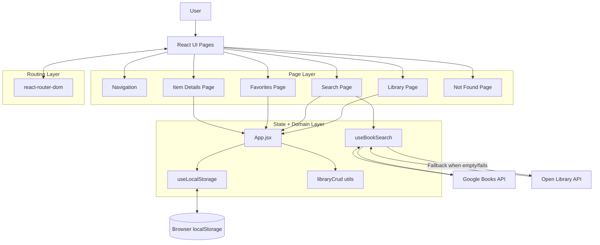
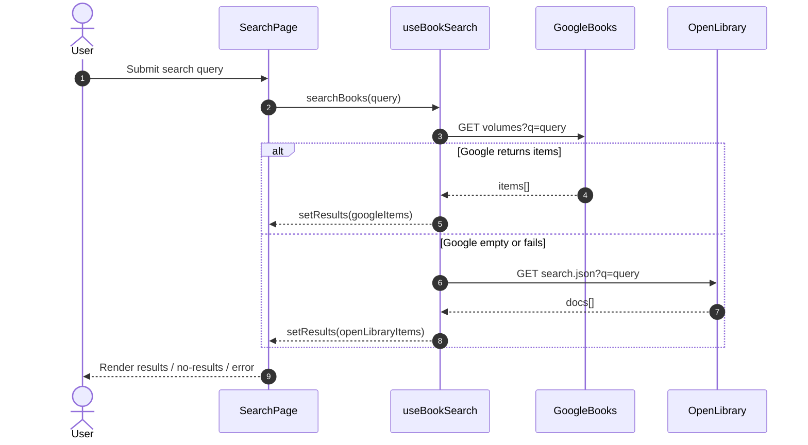

# Personal Library App

A React + Vite application for searching books, managing a personal collection, and persisting that collection in local storage.

## Architecture Diagram



### Search Request Lifecycle (Sequence)



## Application Flow

### 1. App Boot

1. `main.jsx` mounts the app inside `BrowserRouter`.
2. `App.jsx` initializes shared library state with `useLocalStorage("personal-library-items", [])`.
3. `useLocalStorage` reads from `window.localStorage`, parses JSON, and recovers gracefully from corrupted data.

### 2. Routing and Navigation

1. `Navigation.jsx` provides links to `/library`, `/search`, and `/favorites`.
2. `App.jsx` defines routes:
   - `/` redirects to `/library`
   - `/library` shows full collection and filters
   - `/search` performs API search and add-to-library
   - `/favorites` shows favorite items
   - `/item/:itemId` shows detail and update/delete actions
   - `*` shows 404 page

### 3. Search Flow (with API Fallback)

1. User submits a query on `SearchPage`.
2. `useBookSearch.searchBooks` calls `fetchBookResults`.
3. `fetchBookResults` behavior:
   - Calls Google Books first.
   - If Google returns items, map and return those.
   - If Google returns no items or fails, call Open Library.
   - Map Open Library docs into the same internal item shape.
4. UI renders results, no-results message, or user-friendly error message.

### 4. CRUD Flow

1. `App.jsx` owns the library state and passes handlers to pages/components.
2. Operations are implemented in `src/utils/libraryCrud.js`:
   - Create: `addLibraryItem`
   - Read: `findLibraryItemById` and page-level rendering
   - Update: `updateLibraryItem` (includes nested `details` merge)
   - Delete: `removeLibraryItem`
   - Favorite toggle: `toggleFavoriteById`
3. All state changes are immutable (map/filter/spread patterns).

### 5. Persistence Flow

1. Any library update triggers `useLocalStorage` effect.
2. Updated data is serialized and saved back to local storage.
3. Refreshing the page restores the saved collection.

## Implementation Details

### Tech Stack

- React 19
- Vite 8
- React Router DOM 7
- PropTypes for runtime prop validation
- Jest for unit testing
- ESLint for linting

### Project Structure

```text
src/
	App.jsx
	main.jsx
	App.css
	index.css
	components/
		Navigation.jsx
		LibraryItem.jsx
		SearchResultCard.jsx
	hooks/
		useLocalStorage.js
		useBookSearch.js
	pages/
		LibraryPage.jsx
		SearchPage.jsx
		FavoritesPage.jsx
		ItemDetailsPage.jsx
		NotFoundPage.jsx
	utils/
		libraryCrud.js
test/
	libraryCrud.test.js
	useBookSearchApi.test.js
```

### Data Model

Each library item uses a normalized shape:

- `id`, `title`, `author`, `description`, `thumbnail`
- `isFavorite`, `readingStatus`, `rating`, `dateAdded`
- `details`: `genre`, `notes`, `source`

### Error Handling

- Empty search input returns a friendly validation message.
- Search API failures show a user-friendly error in UI.
- Local storage parse failures reset to defaults with a storage warning.

### Testing

Unit tests are located in `test/`:

- `libraryCrud.test.js` validates CRUD and immutability behavior.
- `useBookSearchApi.test.js` validates endpoint order and fallback behavior.

## Setup

### Prerequisites

- Node.js 18+
- npm 9+

### Install

```bash
npm install
```

### Run Development Server

```bash
npm run dev
```

### Run Lint

```bash
npm run lint
```

### Run Tests

```bash
npm test
```

### Build for Production

```bash
npm run build
```

### Preview Production Build

```bash
npm run preview
```

## API Endpoints

- Google Books: `https://www.googleapis.com/books/v1/volumes?q=<query>&maxResults=20`
- Open Library fallback: `https://openlibrary.org/search.json?q=<query>`

## Notes for Deployment

- This project is a static Vite app and can be deployed to Netlify or Vercel.
- Browser local storage is per-user and per-browser; data does not sync across devices.
