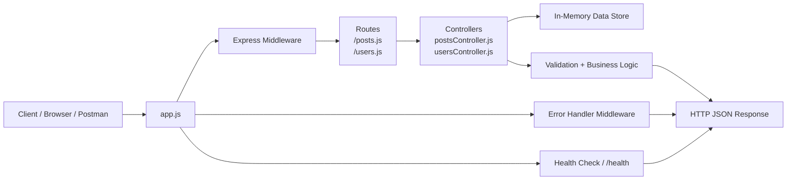

# Blog API Project

A lightweight Express.js API for managing blog posts and users. The app uses in-memory data storage, validation checks, and a simple health endpoint so it can be tested locally without external dependencies.

## Architecture Overview

The application follows a typical Express layered architecture:



### Flow description

1. The entry file, `app.js`, creates the Express server and sets up middleware.
2. Requests are routed to either the posts or users router.
3. Each route calls a controller that handles the request logic.
4. The controller validates input and updates the in-memory arrays that represent posts and users.
5. Responses are returned as JSON, and any error handling is routed through the centralized error middleware.

## Project Structure

```text
blog-api-project/
├── app.js                     # Application entry point and server setup
├── package.json               # Scripts and dependencies
├── Blog-Post-API.postman_collection.json
├── scripts/
│   └── run-api-tests.js      # Automated smoke tests for the API
├── routes/
│   ├── posts.js              # Blog post routes
│   └── users.js              # User routes
├── controllers/
│   ├── postsController.js    # Blog post business logic
│   └── usersController.js    # User business logic
├── middleware/
│   └── errorHandler.js       # Centralized error response handling
└── README.md                 # Project documentation
```

## Features

- CRUD API for blog posts
- CRUD API for users
- Input validation for required fields and invalid values
- Health check endpoint for readiness checks
- Local smoke tests that start the server and make real HTTP requests
- Postman collection for manual API testing

## API Endpoints

### Root

- `GET /` — returns API information and available routes

### Health

- `GET /health` — returns service status

### Posts

- `GET /api/posts`
- `GET /api/posts/:id`
- `POST /api/posts`
- `PUT /api/posts/:id`
- `DELETE /api/posts/:id`

### Users

- `GET /api/users`
- `GET /api/users/:id`
- `POST /api/users`
- `PUT /api/users/:id`
- `DELETE /api/users/:id`

## Setup

### 1. Install dependencies

```bash
npm install
```

### 2. Start the API

Run the app in normal mode:

```bash
npm start
```

Or run it with nodemon for auto-reload during development:

```bash
npm run dev
```

The server runs on:

```text
http://localhost:3000
```

You can verify it is running by visiting:

```text
http://localhost:3000/health
```

## Testing

This project includes two different test flows:

- a Node-based smoke test that starts the app and exercises the live HTTP endpoints
- a Newman/Postman run for API collection validation and result export

### Run the Node-based API tests

```bash
npm test
```

This runs the script in `scripts/run-api-tests.js`, which checks:

- the root endpoint
- the health endpoint
- list/create/read/update/delete behavior for posts
- list/create/read/update/delete behavior for users
- validation failures and not-found responses

### Run the Postman collection

The project includes a Postman collection for manual API checks and scripted collection runs.

```bash
npm run test:postman
```

This executes the collection saved as `Blog-Post-API.postman_collection.json` and exports the results to `test-results.json`.

If you want a quieter CLI run without the interactive Newman output, use:

```bash
npm run test:postman:silent
```

## Example Commands

```bash
# Start server
npm start

# Start in dev mode with auto-reload
npm run dev

# Run automated smoke tests
npm test

# Run Postman collection
npm run test:postman

# Run Postman collection silently
npm run test:postman:silent
```

## Notes

- The API stores data in memory while the server is running.
- Data resets when the server stops or restarts.
- The smoke tests are useful for verifying the API flow end-to-end before manual testing or deployment.
